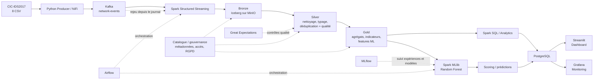

# SOC-STREAM — Architecture technique

## 1. Objectif

SOC-STREAM est une plateforme Big Data de détection d'intrusions réseau. Elle exploite les flux du dataset CIC-IDS2017 pour distinguer le trafic **BENIGN** du trafic **ATTACK**, conserver les événements, produire des données analytiques et alimenter un tableau de bord.

## 2. Choix architectural : Kappa

Le projet retient une architecture **Kappa** : les événements sont publiés dans Kafka puis traités par un pipeline de streaming commun. Kafka conserve le journal d'événements et permet de rejouer les données pour retraiter l'historique après une évolution des règles ou du modèle.

Ce choix évite de maintenir deux implémentations métier distinctes batch et streaming. Pour le prototype académique, le rejeu est limité par la rétention Kafka et les ressources disponibles sur Docker Desktop.

> CIC-IDS2017 est fourni sous forme de fichiers CSV. Le producteur Python (ou NiFi, selon l'intégration retenue) les lit et publie progressivement les enregistrements dans Kafka afin de simuler un flux. Il s'agit d'une simulation à partir d'un dataset historique, et non d'une capture réseau live.

## 3. Vue d'ensemble des flux

## 4. Composants et responsabilités

| Composant | Responsabilité dans SOC-STREAM |
|---|---|
| CIC-IDS2017 | Source historique de flux réseau labellisés |
| Python Producer / NiFi | Lecture des CSV, normalisation minimale et publication progressive |
| Kafka | Transport, tampon et journal des événements ; topic principal `network-events` |
| Spark Structured Streaming | Consommation Kafka, parsing, transformations et écriture des couches |
| MinIO | Stockage objet compatible S3 des fichiers de données |
| Apache Iceberg | Format de tables du Lakehouse et gestion des métadonnées/snapshots |
| Bronze | Conservation des événements reçus, avec source et horodatage d'ingestion |
| Silver | Données nettoyées, typées, dédupliquées et contrôlées |
| Gold | Agrégats métier, indicateurs et jeu de features destiné au ML |
| Great Expectations | Contrôles de qualité à l'entrée de Silver |
| Spark SQL | Requêtes analytiques et agrégations |
| Spark MLlib | Entraînement et évaluation du modèle de classification |
| MLflow | Traçabilité des expériences, paramètres, métriques et modèles |
| Airflow | Orchestration des étapes du pipeline dans un DAG |
| PostgreSQL | Stockage des prédictions et des alertes consommées par l'application |
| Streamlit | Dashboard métier : trafic, attaques, tendances et alertes |
| Grafana | Monitoring technique et métriques d'exécution |
| Catalogue et gouvernance | Documentation des données, contrôle des accès et mesures de conformité RGPD |

## 5. Couches Medallion

### Bronze — données brutes

- Recevoir les messages Kafka sans transformation métier destructive.
- Ajouter les métadonnées techniques : `event_id`, source, topic/partition/offset si disponibles, et `ingestion_timestamp`.
- Écrire les données dans des tables Iceberg stockées sur MinIO.
- Préserver le label original `Label` et le message source pour permettre l'audit et le rejeu.

### Silver — données conformes

- Normaliser les noms de colonnes et les types.
- Traiter les valeurs nulles, non numériques et infinies selon des règles documentées.
- Dédupliquer à partir d'une clé d'événement stable.
- Conserver le label multiclasses original et produire la cible binaire `target` : 0 pour BENIGN, 1 pour ATTACK.
- Exécuter les contrôles Great Expectations et isoler ou reporter les lignes invalides.

### Gold — données orientées décision

- Produire des agrégats par fenêtre temporelle, classe et type d'attaque.
- Calculer des indicateurs : volume de flux, nombre d'attaques, proportion d'attaques et principales catégories.
- Préparer les features nécessaires à l'entraînement et au scoring.
- Exposer les résultats à Spark SQL, au modèle et au dashboard.

## 6. Machine Learning et alertes

Le cas d'usage principal est une classification binaire **BENIGN / ATTACK**. Le modèle demandé dans le périmètre projet est entraîné et évalué avec Spark MLlib, avec feature engineering documenté. Les métriques à rapporter comprennent au minimum précision, rappel, F1-score et matrice de confusion ; elles doivent être calculées sur un jeu de test séparé et ne seront renseignées qu'après exécution réelle.

Le scoring produit une prédiction et, selon un seuil ou une règle explicitement documentée, une alerte. Les prédictions et alertes utiles au dashboard sont enregistrées dans PostgreSQL. Le label d'origine peut être conservé pour l'évaluation, mais ne doit pas être utilisé comme feature d'entrée du modèle.

## 7. Orchestration, observabilité et gouvernance

- Airflow orchestre les étapes planifiées et les traitements de préparation, d'entraînement et de maintenance ; le traitement continu Spark reste un service long-running supervisé.
- MLflow enregistre les paramètres, métriques et artefacts du modèle.
- Grafana suit la santé des services et les métriques techniques disponibles.
- Le catalogue décrit les jeux de données, schémas, propriétaires et transformations.
- Les mesures de sécurité/RGPD doivent être documentées : minimisation, absence de données directement identifiantes dans les événements conservés si non nécessaires, contrôle d'accès, secrets hors Git et politique de rétention.

## 8. Déploiement local

Docker Compose sert à lancer les services nécessaires sur Windows 11 avec Docker Desktop. Le déploiement doit rester progressif : démarrer d'abord Kafka et MinIO, valider l'ingestion et Bronze, puis ajouter Spark/Iceberg, la qualité, le ML, PostgreSQL et les interfaces. Les versions, ports, volumes et variables d'environnement seront consignés dans le fichier `docker-compose.yml`.

## 9. Limites et points de vigilance

- CIC-IDS2017 est un dataset historique ; le flux Kafka est simulé par publication progressive, pas issu d'une sonde réseau en direct.
- Les échantillons préparés pour le développement ne remplacent pas l'évaluation sur un découpage entraînement/test sans fuite de données.
- Le dataset est déséquilibré et certaines attaques sont très rares ; l'évaluation doit inclure le rappel et le F1 par classe lorsque possible.
- Les identifiants d'événement doivent rester uniques et stables pour permettre la déduplication et le rejeu.
- Les composants optionnels doivent être ajoutés uniquement si les ressources locales et le calendrier le permettent.

## 10. Statut

Ce document décrit l'architecture cible. La présence d'un composant dans ce schéma ne signifie pas qu'il est déjà déployé ou validé. L'état réel d'implémentation et les résultats des tests doivent être mis à jour au fur et à mesure dans le README et le rapport.
